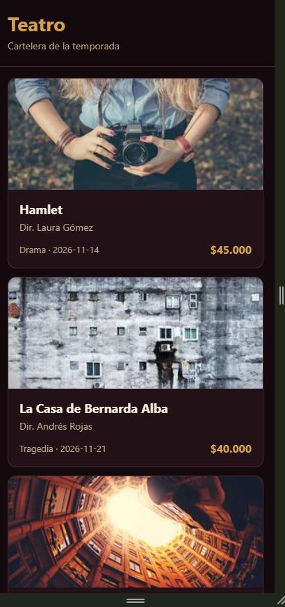

# Semana 01 — App de Tarjetas: Teatro

Autor: Hernán Eduardo Robledo Montaña
Ficha: 3407193

App móvil de pantalla única hecha con React Native y Expo que muestra la cartelera de un teatro como una lista de tarjetas.

## Dominio: Teatro

Cada tarjeta representa una obra con su título, director o compañía, género, fecha de función y precio. La pantalla principal tiene un header con el nombre del dominio ("Teatro") y el subtítulo "Cartelera de la temporada".

## Pantalla



> Captura de la app en ejecución en web.

## Stack

| Tecnología | Versión |
|---|---|
| Expo SDK | 57.0.31 |
| React Native | 0.86.3 |
| React | 19.2.3 |
| TypeScript | 6.0.3 |
| Gestor de paquetes | pnpm |

## Cómo ejecutar

```bash
pnpm install
pnpm start
```

Para verla en el navegador, las dependencias web (`react-dom` y `react-native-web`) ya vienen fijadas en `package.json`:

```bash
pnpm web
```

Probada en: web y Expo Go en celular.

## Estructura

```
src/
├── types/index.ts          # Interfaz Item (obra)
├── data/mockData.ts        # Datos de ejemplo del dominio
├── components/ItemCard.tsx # Tarjeta reutilizable
└── screens/HomeScreen.tsx  # Header + lista de tarjetas
```

## Modelo de datos

```ts
export interface Item {
  id: string;
  name: string;       // título de la obra
  subtitle: string;   // director o compañía
  imageUri: string;
  genre: string;
  date: string;
  price: number;      // en COP
}
```

## Decisiones de diseño

- **Tarjeta con `Pressable`:** cambia la opacidad al tocarla (`pressed`), lo que da feedback visual al usuario.
- **Layout con Flexbox:** imagen arriba y texto debajo (eje vertical por defecto); la fila de género/fecha y precio usa `flexDirection: 'row'` con `justifyContent: 'space-between'`.
- **Imagen con `resizeMode="cover"`:** recorta en vez de estirar, para evitar deformaciones.
- **Precio formateado** con `toLocaleString('es-CO')`.
- **Paleta:** se aplicó la paleta vino y oro (fondo `#14090c`, tarjeta `#221116`, acento dorado `#d4a24c`, texto `#f5ecd9` y texto secundario `#b8a58a`).
- **Lista con `ScrollView` y `map`:** cada tarjeta usa `key={item.id}`. En la Semana 2 se cambia a `FlatList`.

## Requisitos de la semana

- [x] Pantalla principal con lista de tarjetas (`ScrollView`)
- [x] Mínimo 3 tarjetas con datos del dominio (4 en `mockData.ts`)
- [x] Cada tarjeta con imagen, dos textos con estilos distintos y un `Pressable` con feedback visual
- [x] Header con el nombre del dominio
- [x] Estilos con `StyleSheet.create`, sin estilos inline
- [x] Interfaces TypeScript para los datos
- [x] Sin `position: 'absolute'` ni librerías de UI externas

## Problemas encontrados y soluciones

| Problema | Causa | Solución |
|---|---|---|
| Pantalla en blanco en web | `react` (19.2.3) y `react-dom` (19.0.0) con versiones distintas | `pnpm add react-dom@19.2.3` |
| Subrayado rojo en `tsconfig.json` | Ruta en `paths` sin `./` (no hay `baseUrl`) | Usar `"@/*": ["./src/*"]` |
| Tarjetas descuadradas | Se renderizaban dentro del estilo del placeholder (`emptyState`) | Renderizar `ItemCard` directo dentro del `ScrollView` |

## Pendientes

- Las imágenes se cargan desde URLs temáticas estables de Unsplash curadas para el dominio teatral.

## Mapa de archivos por semana

| Archivo | Semana de autoría | Propósito |
|---|---|---|
| `starter/src/types/index.ts` | Semana 01 | Interfaz `Item` (modelo de datos de la obra) |
| `starter/src/data/mockData.ts` | Semana 01 | Cartelera inicial con 4 obras teatrales |
| `starter/src/components/ItemCard.tsx` | Semana 01 | Tarjeta de obra con `Pressable` accesible y feedback `pressed` |
| `starter/src/screens/HomeScreen.tsx` | Semana 01 | Pantalla principal con header y `ScrollView` |
| `starter/App.tsx` | Semana 01 | Componente raíz |
| `starter/index.js` | Semana 01 (transversal) | Entrypoint web y móvil con `registerRootComponent` |
